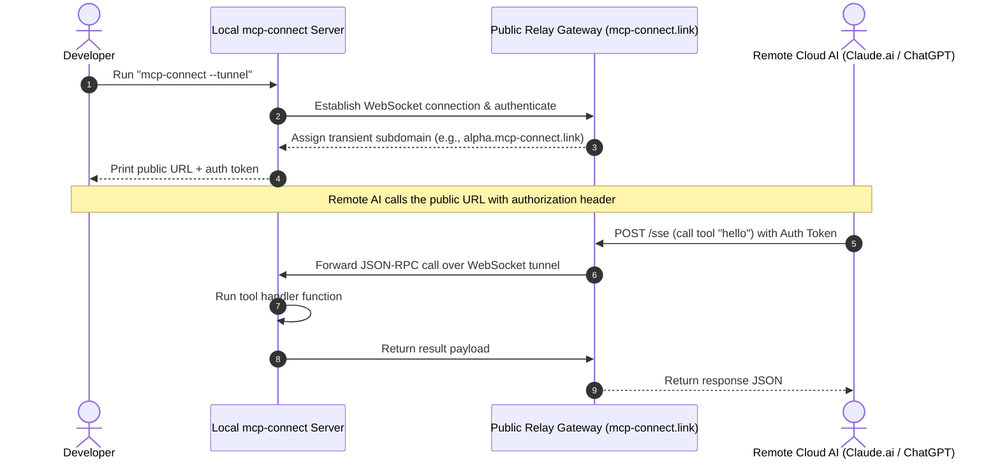

# Architecture Proposal: Evolving mcp-connect into a Multi-Transport & Secure Bridge Framework

This proposal outlines the evolution of [@myatkyawthu/mcp-connect](file:///Users/myatkyawthu/Documents/MCP_Integration_Package-NPM) to make local MCP servers seamlessly accessible to remote and cloud-based AI tools (e.g., Claude.ai, ChatGPT, or custom cloud agents). It shifts the focus from building a new AI assistant to creating a **developer-first MCP creation framework** with built-in tunneling, local dashboarding, and multi-transport capabilities.

---

## 1. The Core Vision: The Developer's "Bridge"

Currently, developing an MCP server is straightforward for local IDEs (Cursor/Claude Desktop via `stdio`), but exposing that same server to remote web-based AI tools or cloud agents is difficult. NATs, firewalls, and complex CORS/SSL configurations create high setup barriers.

The goal for the next generation of `mcp-connect` is to allow developers to build their MCP server once and instantly run it across three modes:

```
                  +--------------------------------+
                  |  defineMCP() Configured Server |
                  +---------------+----------------+
                                  |
         ┌────────────────────────┼────────────────────────┐
         ▼                        ▼                        ▼
  [ Mode 1: Local Stdio ]  [ Mode 2: Local SSE ]   [ Mode 3: Secure Tunnel ]
   - IDE Child Processes    - Local HTTP Server     - Persistent WebSocket
   - Standard Pipe I/O      - Port-based (e.g. 3000) - Connected to public Relay
                            - CORS & SSE support    - Transient HTTPS link
```

---

## 2. Technical Architecture: How the "Bridge" Works

To bridge local servers to the cloud, the architecture introduces a **public Relay Gateway** and a **local Tunnel Client** built directly into `mcp-connect`.

### System Sequence Diagram



### Components

1. **Multi-Transport Listener (`@myatkyawthu/mcp-connect/server`)**:
   - Automatically supports both `StdioServerTransport` and `SSEServerTransport` based on how the server is launched.
2. **WebSocket Tunnel Client**:
   - A built-in connection client that initiates an outbound connection to `wss://tunnel.mcp-connect.link`.
   - Outbound-only connectivity bypasses local firewalls and NAT configurations.
3. **Public Relay Gateway (`relay-server`)**:
   - A lightweight, stateless public server that maps incoming HTTPS requests from cloud clients (via standard headers) and routes them into the corresponding local WebSocket connection.
4. **E2E Payload Protection (Privacy Option)**:
   - For sensitive local databases, the local server and the remote client can use symmetric encryption. The public Relay gateway only acts as a router, unable to inspect or decrypt the tool payloads.

---

## 3. Developer Experience & API Design

Developers should not need to write networking boilerplate. The configuration remains simple and declarative.

### Updated Developer API

The framework handles transport switching internally based on the input configuration or runtime CLI flags:

```javascript
// mcp.config.js
import { defineMCP } from "@myatkyawthu/mcp-connect";

export default defineMCP({
  name: "Local DB Inspector",
  version: "1.0.0",
  // New configuration options
  server: {
    transport: "hybrid",     // Support stdio, sse, or hybrid
    port: 3000,              // Port for SSE/HTTP
    tunnel: {
      enabled: true,         // Automatically spin up a secure cloud tunnel
      token: process.env.MCP_TUNNEL_TOKEN // Optional authorization check
    }
  },
  tools: [
    ["query_db", async ({ sql }) => {
      // Direct access to local databases
      return executeSQL(sql);
    }]
  ]
});
```

### CLI Command Options

```bash
# Start in default local Stdio mode (for Cursor/Claude Desktop)
npx mcp-connect

# Start local HTTP/SSE server on port 8080
npx mcp-connect --port 8080

# Start and expose the local server via the public bridge tunnel
npx mcp-connect --tunnel
```

---

## 4. Security Framework

Exposing local system capabilities to remote cloud networks requires a strong security model:

```
            [ Remote AI Client Request ]
                         │
                         v
             [ Relay Gateway Router ]
     - Matches subdomain to active WebSocket connection
                         │
                         v
      [ Local mcp-connect Authorization Filter ]
     - Checks authentication tokens
     - Evaluates permission rules (e.g. read vs. write)
                         │
         ┌───────────────┴───────────────┐
         ▼                               ▼
    [ Read Tool ]                  [ Write / Shell Tool ]
   - Execute tool                 - Intercept & wait
   - Return response              - Print console confirmation prompt:
                                    "Allow execution of query_db? [y/N]"
```

1. **Subdomain Token Verification**:
   - The Relay gateway routes traffic only if it matches a unique connection ID.
   - The local `mcp-connect` instance checks the incoming authorization header against a local key.
2. **Interactive CLI Prompting**:
   - When a remote request attempts to invoke a tool marked as destructive, the local terminal prints a prompt and waits for the developer to confirm the action before executing it.
3. **CORS & Origin Filtering**:
   - In SSE mode, developers can restrict connections to specific origins (e.g., `https://claude.ai` or `https://chatgpt.com`).

---

## 5. Local Inspection Console

To help developers inspect, debug, and optimize their MCP tools, `mcp-connect` will launch a local development console running on localhost:

```
┌────────────────────────────────────────────────────────┐
│ mcp-connect developer dashboard          localhost:4040 │
├────────────────────────────────────────────────────────┤
│ [Requests Logs]                                        │
│  16:31:02  [Call] query_db    (duration: 45ms)  [OK]   │
│  16:31:45  [Call] query_db    (duration: 12ms)  [ERR]  │
│                                                        │
│ [Request Details]                                      │
│  Arguments: { "sql": "SELECT * FROM users LIMIT 5" }   │
│  Response:  [ { "id": 1, "username": "dev_user" } ]    │
└────────────────────────────────────────────────────────┘
```

- **Visual Logger**: Displays incoming payloads, JSON-RPC schemas, and tool execution durations.
- **Mock Executor**: Allows developers to test their tools directly from the browser dashboard, simulating model requests before connecting to a live client.

---

## 6. Project Roadmap

```
Phase 1: Dual-Transport Support [DONE]
├─ [x] Implement HTTP/SSE server bindings alongside Stdio
└─ [x] Add `--port` command line interface flag

Phase 2: Local Inspector Console [DONE]
├─ [x] Build the localhost web dashboard interface
└─ [x] Log tool execution details and arguments locally

Phase 3: Secure Relay Tunneling [DONE]
├─ [x] Build the remote Relay Gateway routing service
├─ [x] Add `--tunnel` SSE bridge capabilities (outbound, NAT-bypassing)
└─ [x] Implement interactive CLI prompt confirmation for destructive tools

Security & API Config [DONE]
├─ [x] CORS origin allowlist (server.cors.origins — restrict to specific origins)
├─ [x] Bearer token auth enforcement (MCP_TUNNEL_TOKEN / server.tunnel.token)
├─ [x] E2E AES-256-GCM payload encryption (server.tunnel.encryptionKey)
└─ [x] Config-driven transport + tunnel settings (server.port, server.transport, server.tunnel)
```
